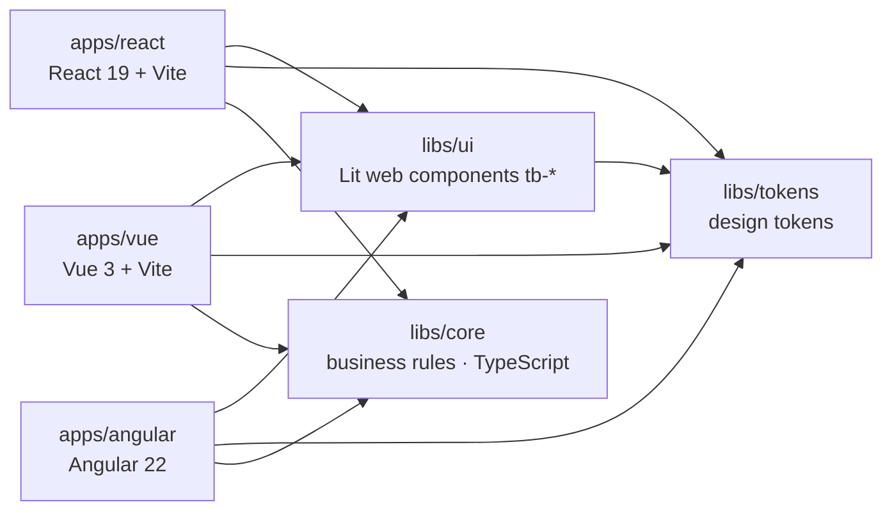

# Tidebook

Tidebook is a booking site for coastal stays: pick your dates and guests, choose a room or
bungalow, apply a promo code and confirm. It is a portfolio project that shows one design system
and one business-logic library shared by the same app written in React, Vue and Angular, inside an Nx
monorepo.

**Live demos:** [React](https://sbenitezma-tidebook-react.netlify.app) ·
[Vue](https://sbenitezma-tidebook-vue.netlify.app) ·
[Angular](https://sbenitezma-tidebook-angular.netlify.app) ·
[Storybook](https://sbenitezma-tidebook-storybook.netlify.app)

Try a promo code straight from the URL:
[`?promo=WELCOME10`](https://sbenitezma-tidebook-react.netlify.app/?promo=WELCOME10) (10 % off),
`SUMMER15` (15 % off) or `SPRING20` (expired, shows a clear message).

## Architecture



| Package        | What it holds                                                                                                                                                                                                                        |
| -------------- | ------------------------------------------------------------------------------------------------------------------------------------------------------------------------------------------------------------------------------------ |
| `libs/tokens`  | Colours, typography, spacing, radii and shadows, defined once and exported as TS constants and CSS custom properties (`--tb-*`).                                                                                                     |
| `libs/core`    | Pure TypeScript: dates, guests and capacity, promo codes, pricing, booking creation and storage. No framework, no DOM.                                                                                                               |
| `libs/ui`      | The page layout stylesheet, room photos, a Storybook and ten Lit web components (`tb-button`, `tb-text-field`, `tb-date-field`, `tb-counter`, `tb-badge`, `tb-alert`, `tb-room-card`, `tb-price-summary`, `tb-header`, `tb-footer`). |
| `apps/react`   | The booking app in React 19: presentation and UI state only.                                                                                                                                                                         |
| `apps/vue`     | The same booking app in Vue 3: presentation and UI state only.                                                                                                                                                                       |
| `apps/angular` | The same booking app in Angular 22 with signals: presentation and UI state only.                                                                                                                                                     |
| `apps/e2e`     | Playwright end-to-end tests of the booking flow, run against all three apps on desktop and mobile, using the production builds.                                                                                                      |

## Why it is built this way

The stack comes from a market study of the most widely used frontend technologies today, which
this project builds on and deepens.

- **Monorepo with Nx.** One repository, one install, one version of each library. Nx knows the
  dependency graph, so `nx affected` only lints, tests and builds what a change can break, and
  results are cached.
- **Web Components for the design system.** Custom elements are a browser standard, so the same
  `tb-*` components work in React, Vue, Angular or plain HTML. The design system is written once
  and outlives any framework choice.
- **A framework-free core.** Booking rules are plain functions with no framework or DOM
  dependency (the core's tsconfig does not even include the DOM types). Every app gets the same
  totals, and the rules are tested in milliseconds.
- **Test-driven development.** Each core rule started as a failing test. The core has 100 %
  coverage, enforced by the test runner.
- **Storybook.** Every component state and the token palette are documented and browsable on
  their own, with an accessibility check (axe) on each story.
- **Design tokens.** One typed source of truth for the visual language. Components reference
  tokens through typed helpers, so a misspelt token is a compile error, not a silent fallback.

Every technical decision is recorded with its reason in [`docs/decisions.md`](docs/decisions.md).

## Getting started

Requires Node 22.22.3 or later (Angular 22's minimum).

```bash
npm install
npm run dev              # React app on http://localhost:5173
npm run dev:vue          # Vue app on http://localhost:5174
npm run dev:angular      # Angular app on http://localhost:5175
npm run storybook        # Storybook on http://localhost:6006
```

Main Nx commands:

```bash
npx nx test core          # core business rules with coverage
npx nx e2e e2e            # Playwright E2E on all three apps (also: npm run e2e)
npx nx build-storybook ui # static Storybook in libs/ui/dist/storybook
npm run check             # lint, typecheck, test, build and Storybook build for everything
npm run affected          # the same plus E2E, only for what changed since main
npx nx graph              # explore the project graph
```

## Business rules

All rules live in `libs/core` and are covered by unit tests.

- **Price.** Total = price per night × number of nights − discount. Amounts are integer cents;
  the discount is rounded to the nearest cent. `quoteStay` is the only function that computes a
  price, and the booking stores the exact quote the guest saw.
- **Promo codes.** A code from the URL (`?promo=CODE`) or the promo field is trimmed, upper-cased
  and looked up in the code list. Unknown or expired codes show a message and apply no
  discount. The value is never read as a number, so `?promo=100` is just an unknown code. Codes
  are valid up to and including their expiry date.
- **Capacity.** Adults (1–4) and children (0–3) both count towards a room's maximum guests. A
  booking over capacity is shown as a warning and cannot be confirmed.
- **Dates.** Check-in defaults to today and check-out to tomorrow. Check-in cannot be in the past
  and the stay must be at least one night. Night counts use UTC calendar days, so daylight
  saving changes never add or remove a night.
- **Saving.** Confirmed bookings are stored in `localStorage`. If the browser blocks storage,
  the booking still completes and the guest is told it was not saved on the device.

## React, Vue and Angular side by side

The three apps render the same markup with the same `tb-*` components, call the same `libs/core`
functions and pass the same Playwright suite. What changes is how each framework talks to a web
component:

| Concern           | React 19                                         | Vue 3                                                       | Angular 22                                                     |
| ----------------- | ------------------------------------------------ | ----------------------------------------------------------- | -------------------------------------------------------------- |
| Setup             | Nothing: custom elements are supported natively. | `isCustomElement: (tag) => tag.startsWith('tb-')`.          | `schemas: [CUSTOM_ELEMENTS_SCHEMA]` on each component.         |
| Objects, booleans | Set as properties: `room={room}`.                | Set as properties: `:room="room"`.                          | Property binding: `[room]="room"`.                             |
| Events            | `ontb-select={(event) => …}`                     | `@tb-select="…"`                                            | `(tb-select)="…"`                                              |
| Typed events      | Augment `JSX.IntrinsicElements`.                 | Augment `GlobalComponents`, checked by `vue-tsc`.           | Read from `HTMLElementEventMap`, checked by `strictTemplates`. |
| UI state          | `useState`, recomputed on every render.          | `ref` and `computed`, recomputed when a dependency changes. | `signal` and `computed`, zoneless change detection.            |

React and Vue get their typings from [`apps/react/src/custom-elements.ts`](apps/react/src/custom-elements.ts)
and [`apps/vue/src/custom-elements.ts`](apps/vue/src/custom-elements.ts), which reuse the
component classes and their typed `CustomEvent`s. Angular needs no extra file: its template type
checker reads the `HTMLElementEventMap` entries that `libs/ui` declares, so a misread
`event.detail` fails the build in all three apps. Each app runs `import '@tidebook/ui'` before the
first render, so the elements are defined when the framework sets their properties.

## Deployment

Each app is its own Netlify site, built from the same repository with its own `netlify.toml`
(Nx build command, publish folder, Node 22 and an SPA redirect).

To avoid rebuilding sites that did not change, each `netlify.toml` has an `ignore` command:

```toml
ignore = "git diff --quiet $CACHED_COMMIT_REF $COMMIT_REF -- apps/react libs package.json package-lock.json nx.json tsconfig.base.json"
```

Netlify skips the build when the command exits with 0, which `git diff --quiet` does when none of
those paths changed since the last deploy. A change to `apps/vue` does not redeploy the React
site; a change to any shared library redeploys every app.

## Roadmap

Tidebook keeps growing in these directions:

- **Continuous integration** with GitHub Actions running `npm run affected` on every pull request.
- **Form-associated custom elements** (`ElementInternals`), so the `tb-*` fields work inside a
  native `<form>`.

## Credits

The room photos were created for Tidebook and show fictional places; the logo is original SVG artwork.

Made by [Sonia Benítez](https://github.com/sbenitezma).
